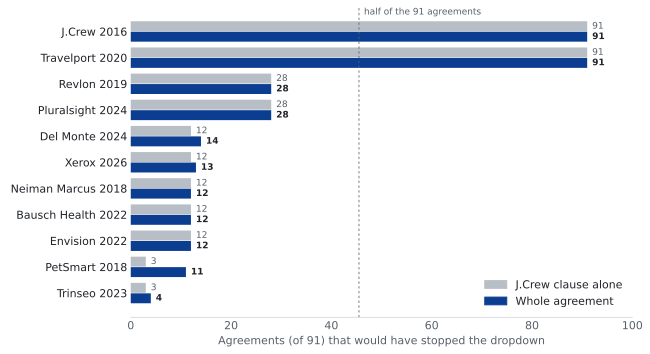
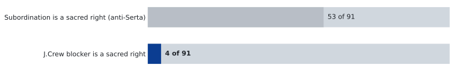
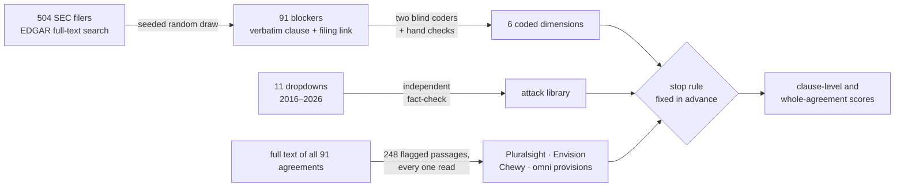

<div align="center">

# Do J.Crew Blockers Block?

### A backtest of 91 credit agreements against eleven real dropdowns

**Saurav Sharma** · Working paper, November 2026

[**Paper (PDF)**](paper/Sharma_JCrew_Blockers_2026.pdf) &nbsp;·&nbsp; [Methods](docs/METHODS.md) &nbsp;·&nbsp; [Data dictionary](docs/DATA.md) &nbsp;·&nbsp; [Pre-registration ledger](docs/PREREGISTRATION.md) &nbsp;·&nbsp; [Challenge a call](docs/AUDIT.md)

[](https://github.com/saurav0369/jcrew-blockers/actions/workflows/reproduce.yml)
[](https://doi.org/10.5281/zenodo.24480033)


</div>

<br>

Lenders now ask for a "J.Crew blocker" in about half of new leveraged loans.[^noetica] It is the clause meant to stop a stressed borrower from moving valuable assets beyond its lenders' reach. Whether these clauses would stop the dropdowns borrowers actually execute had not, as far as I could find, been tested in public.

This repository tests it. Each of eleven real dropdowns (2016–2026) is treated as an attack. Each of 91 blockers, drawn at random from credit agreements filed with the SEC, is the defence. Every pair is scored against the contract text under one written rule.

> **The median agreement stops 2 of the 11.** Those two are J.Crew and Travelport, the moves the clause was written for. Against the nine dropdowns that did not follow that pattern, **52 of 91 agreements stop none**, even when every protection anywhere in the contract is counted.

<br>

<picture>
  <source media="(prefers-color-scheme: dark)" srcset="figures/backtest-dark.svg">
  
</picture>

<sub>Grey: the J.Crew clause scored alone. Blue: the whole agreement, crediting Pluralsight, Envision, Chewy and catch-all blockers wherever they appear. Drawn from the data by <code>figures/make_figures.py</code>.</sub>

<br>

## Check it yourself in one minute

```bash
git clone https://github.com/saurav0369/jcrew-blockers && cd jcrew-blockers
python3 reproduce.py
```

`reproduce.py` recomputes **every number in the paper** from the files in `data/` and `stack/`, using only the Python standard library. It also confirms that four pre-registrations are byte-for-byte the files whose fingerprints were recorded before their results were seen. If any number or any fingerprint differs, it exits with an error.

The check was itself tested: planting a wrong published number, deleting a provision, or loosening the scoring rule each makes it fail. The same script runs on every push ([workflow](.github/workflows/reproduce.yml)).

<br>

## Findings

| | Result | 95% interval |
|---|---|---|
| Real dropdowns the median agreement would stop | **2 of 11** | [2, 3] |
| Agreements that stop none of the nine later-pattern dropdowns | **52 of 91** | 47–67% |
| Blockers that protect intellectual property only | 79 of 91 | 78–92% |
| Blockers that do not reach entities outside the group (the Xerox and Trinseo route) | 79 of 91 | 78–92% |
| Blockers that do not reach non-guarantor subsidiaries (the Revlon and Pluralsight route) | 63 of 91 | 59–78% |
| Blockers whose "materiality" test is decided by the borrower | 26 of 72 | 26–48% |
| Blockers entrenched as sacred rights | **4 of 91** | 2–11% |
| Same contracts that entrench protection against *subordination* | **53 of 91** | 48–68% |

<picture>
  <source media="(prefers-color-scheme: dark)" srcset="figures/entrenchment-dark.svg">
  
</picture>

Lenders entrenched their protection against uptiers (Serta) far more often than against dropdowns (J.Crew). That pattern is consistent with Buccola and Nini (2024), observed here in a later sample and on a different measure. Contracts filed in 2025–2026 perform no better than those filed in 2020–2022.

<details>
<summary><b>The result under every alternative rule I could think of</b></summary>
<br>

| Scoring rule | Median stopped | Stop at most 3 | Stop all 11 |
|---|:---:|:---:|:---:|
| J.Crew clause alone | 2 | 58 | 3 |
| J.Crew clause, no credit for non-IP coverage | 2 | 63 | 0 |
| Whole agreement (pre-registered rule) | 2 | 58 | 4 |
| Whole agreement, weak Chewy provisions also count | 3 | 58 | 4 |
| Whole agreement, dropping any one event | 1–2 | 58–69 | — |
| Whole agreement, 10,000 bootstrap resamples | [2, 3] | 54–74% | — |

Computed by `robustness.py`; checked by `reproduce.py`.
</details>

<br>

## How it was built



The rule is short enough to state exactly. A blocker stops a dropdown if it covers **every class of asset moved** and **the place it went**. Every blocker covers unrestricted subsidiaries. Non-guarantor subsidiaries, entities outside the group and assets beyond IP count only where the clause names them. On a multi-step route, stopping any step is enough; on a move to several places at once, every destination must be covered. The formal version is in [docs/METHODS.md](docs/METHODS.md) and Section 4.1 of the paper.

<br>

## What was decided before the results were seen

| Pre-registration | Fixed before | Fingerprint | Outcome |
|---|---|---|---|
| [Census thresholds](preregistration/last_war_prereg.md) | any coding or event result | `7b9d6a32` ✓ | All three held |
| [Whole-agreement rule and five predictions](preregistration/stack_prereg.md) | the scan of 91 agreements | `f23654f1` ✓ | All five held |
| [Retrodiction protocol](preregistration/retrodiction_protocol.md) | any case was modelled | `34d69be3` ✓ | Passed formally (2 of 3) |
| ["Soft unlimited exit" rule](preregistration/sue_rule.md) | any case was scored | `2d23d89f` ✓ | **Failed** (2 of 4 events) |
| [Sacred-rights prediction](preregistration/sacred_prereg.md) | the sacred-rights coding | dated | Held (4%) |

✓ marks a SHA-256 recorded at the time of writing that `reproduce.py` checks against the file today. The full ledger, including what each one does and does not show, is in [docs/PREREGISTRATION.md](docs/PREREGISTRATION.md).

**What did not work is reported with the same weight as what did.** Before the backtest, this project tried to *predict* dropdowns from contract text. Exit-capacity size did not separate borrowers that later executed a dropdown from controls. A pre-registered rule flagged 2 of 4 events, short of the 3 it needed. Both failures are in the paper (Section 7) and in `preregistration/`.

<br>

## What this does not show

- **It is not a legal opinion.** "Stops" means the clause, read as written, reaches the move. It does not mean a court would enforce it that way.
- **No lawyer has reviewed the coding yet.** First-pass coding used language-model tools, and every call was checked by hand against the filing. A 20-contract audit sheet is ready in [`audit/`](audit/), and its results will be published whatever they show.
- **The dropdowns are the ones public reporting documents,** not a random sample.
- **The sample is public-company filers.** Most dropdowns happen at sponsor-backed private borrowers, whose documents may differ.
- **The keyword scan has a blind spot.** It cannot see a protection worded without the searched terms. Combining clauses can also over-credit protection. The two biases run in opposite directions.

<br>

## Repository

```
paper/             the working paper (PDF) and its LaTeX source
data/              91 blockers and 14 dropdowns, each row linked to its source   → docs/DATA.md
stack/             whole-agreement provisions found in the 248 scanned passages
coding/            raw outputs of the two blind coders, before reconciliation
preregistration/   every rule and prediction, written before its result
retrodiction/      case models behind the failed prediction tests
solver/            certified exit-capacity solver used in those tests (needs scipy)
audit/             20-contract sheet for practitioner review                  → docs/AUDIT.md
figures/           every figure, drawn from data/ by make_figures.py
reproduce.py       recomputes every number and checks every fingerprint
robustness.py      confidence intervals and alternative rules
```

<br>

## Disagree with a call?

Every one of the 91 rows quotes its clause and links to the filing on SEC EDGAR, so any call can be checked in about a minute. If you read a clause differently, [open an issue](../../issues/new?template=challenge-a-call.yml) with the row id. Corrections will be logged and the numbers re-run in public. Practitioners willing to review the audit sheet are especially welcome; see [docs/AUDIT.md](docs/AUDIT.md).

<br>

## Cite

```bibtex
@techreport{sharma2026jcrew,
  author      = {Sharma, Saurav},
  title       = {Do {J.Crew} Blockers Block? {A} Backtest of 91 Credit Agreements Against Eleven Real Dropdowns},
  institution = {Working paper},
  year        = {2026},
  doi         = {10.5281/zenodo.24480033},
  url         = {https://doi.org/10.5281/zenodo.24480033}
}
```

<sub>Document search, first-pass coding and editing used language-model tools (Claude, Anthropic); every coding call the results rely on was checked by hand against the filing. Code is MIT-licensed; data and text are CC BY 4.0. Contact: sauravsharma0369@gmail.com</sub>

[^noetica]: Noetica, *H1 2026 Capital Markets Radar Report*, as reported by Thomson Reuters. Noetica's figure covers the deals it tracks; it is cited here for context and is not a finding of this study.
